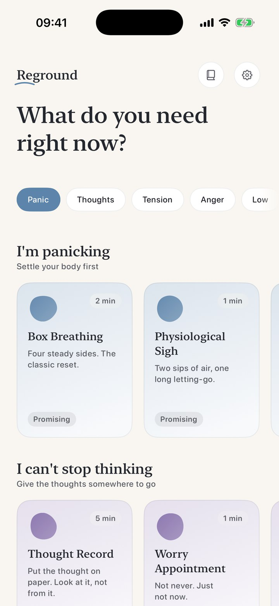
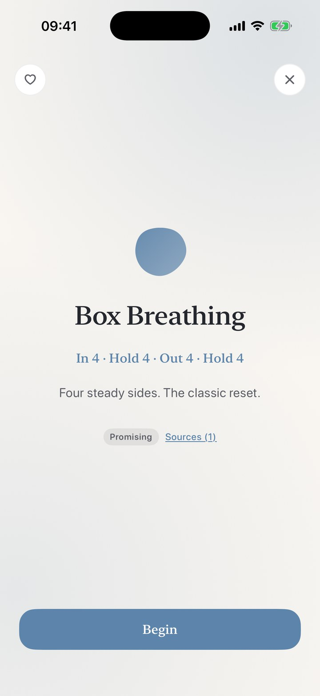
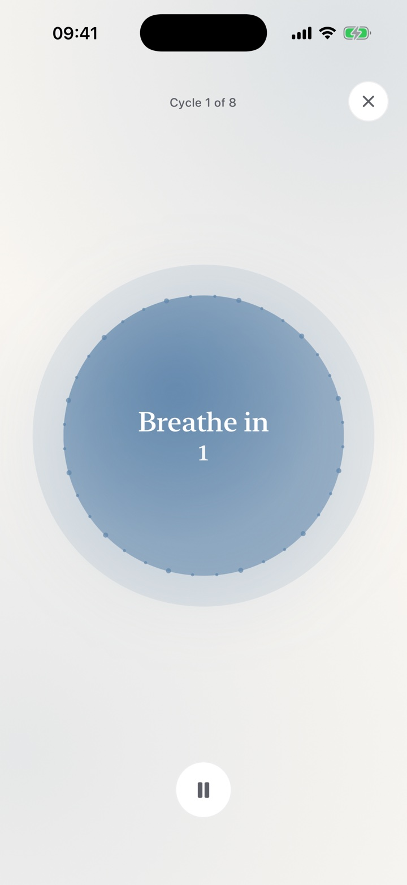

# For the moment your chest tightens.

Source: https://reground.pro/
Summary: 22 calming techniques with honest evidence labels, organized by how you feel right now. No account, no analytics, no subscription. Free to try, $5.99 once.

The wrong moment to browse a library. Reground is a pocket toolkit of **22 calming techniques**, the kind therapists actually teach, organized by how you feel right now. Open the app, tap once, and the phone breathes with you until the ground feels steady again.

[Download Reground on the App Store](https://apps.apple.com/app/id6790840763)

**Free to try.** $5.99 once, if you like it.
No subscription.

Breathe in

4

This is Box Breathing, the real exercise, running right here. Follow it for one minute. In 4 · Hold 4 · Out 4 · Hold 4

## What do you need right now?

Not a course. Not a library to browse. Reground asks one question and hands you the right tool. Each one takes between one and five minutes.

### I’m panicking

Settle your body first

Box Breathing free Physiological Sigh free 5·4·3·2·1 Senses free 4–7–8 Breathing Butterfly Hug

### I can’t stop thinking

Give the thoughts somewhere to go

Worry Dump free Thought Record Worry Appointment Coherent Breathing

### I feel tense

Unwind, one part at a time

Tense & Release Body Scan Alternate Nostril

### I’m angry

Let the heat pass through

The STOP Practice free Cold Reset

### I feel low

Something small and kind

Worry Dump free Three Good Things Kind Wishes Calm Canvas

### I can’t sleep

Quiet the day down

Tomorrow List free Cognitive Shuffle Safe Place

Six techniques are free forever, one for every feeling. And from the Lock Screen widget, solid ground is one tap away.

## Feels like a quiet room, not an app.

Warm paper, a serif voice, soft light. Gentle haptics pace your exhale. Nothing blinks, nothing counts down at you, nothing asks for a streak.

***One question**Pick how you feel, not a category.*

***One tap**The honest label, its sources, then begin.*

***One breath**The phone breathes with you.*

## Honest about the science.

A third of wellness apps cite evidence that doesn’t exist. Reground does the opposite: **every technique carries a plain label and the published sources behind it**. Strong research support, promising, or traditional practice, each with a note on what the study actually measured. No overselling, no borrowed lab coats.

Body ScanStrong evidence

Box BreathingPromising

Alternate NostrilTraditional practice

## Private by design.

What you write at 3 a.m. is nobody’s business, not even ours. There is no account to create and no server to send anything to. The App Store privacy label reads **“Data Not Collected”**, and it’s true in the code, not just the marketing.

No account. No server. No analytics. Everything you write, draw, or practice stays on your phone. Full stop.

## Pay once, if you like it.

Six techniques are free forever. One payment unlocks **every technique, including every one we add later.** Solid ground shouldn’t auto-renew.

$5.99 once. Every technique, forever.

- All 22 techniques, forever
- Every future technique, included
- Purchase restores on any of your devices

A meditation subscription runs about $70 a year. Reground costs about one coffee. Once.

## Put it in your pocket before you need it.

Like a first-aid kit, Reground earns its place on the days you don’t open it.

[Download Reground on the App Store](https://apps.apple.com/app/id6790840763)

---

Reground is a self-care toolkit, not medical care. If you’re struggling, a mental-health professional can help in ways an app can’t.
